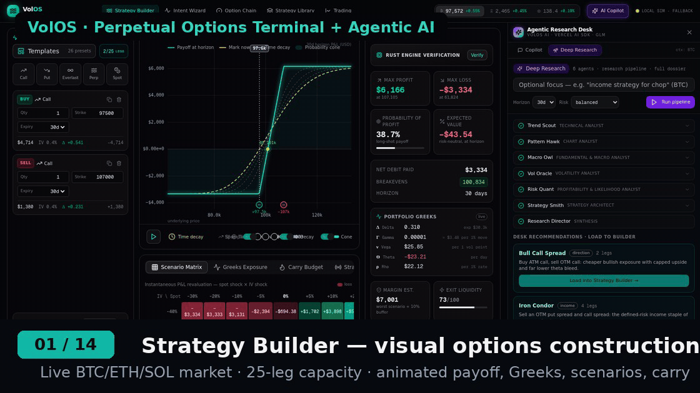

# VolOS — Perpetual Options Strategy Terminal & Trading Platform

A complete, production-style **perpetual options trading platform**: a Rust
matching/trading engine with a Next.js terminal frontend. Strategy analytics,
a full CLOB, strategy-level RFQ across a dealer network, multi-venue smart
order routing (Derive / Paradex / Paradigm), portfolio risk — a catalog of
**131 pre-built strategies supporting up to 25 legs** — a **deeply
integrated agentic AI research desk** built on the **Vercel AI SDK**.

> Research prototype. Simulated market data and liquidity (with live venue
> anchoring when exchange APIs are reachable). Not investment advice.

---



## The Agentic Research Desk (AI Copilot)

An embedded **multi-agent options research team** running on the
[Vercel AI SDK](https://sdk.vercel.ai) (`streamText` / `generateText`,
multi-step tool-calling loops, `useChat` streaming), wired directly into the
terminal's own analytics core — and grounded in **REAL live exchange data**
(Deribit · Bybit · OKX · Aevo · Paradex/tradeparadigm · Derive v3):

| Agent | Specialty | Toolset |
|---|---|---|
| 📈 **Trend Scout** — Technical Analyst | Trend structure, momentum, volume | market state · price history · indicator suite (EMA/RSI/MACD/Stoch/ADX/OBV/VWAP/ATR/Bollinger) — on real Bybit klines |
| 🕯️ **Pattern Hawk** — Chart Analyst | Price action & chart patterns | candlestick patterns (12) · S/R levels · trendlines · double top/bottom · H&S · triangles · channels · flags · Fibonacci |
| 🦉 **Macro Owl** — Fundamental & Macro | Regimes, positioning, scenarios | market environment · real funding/OI/flow · cross-asset correlations · probability-weighted scenario map |
| 🌊 **Vol Oracle** — Volatility Analyst | IV regime & relative value | IV term structure (7/30/90d) · 25Δ skew · HV vs real Deribit IV · IV percentile & regime |
| 🎯 **Risk Quant** — Profitability & Likelihood | Probability & expected value | Monte Carlo (up to 20k fat-tail paths) · POP/EV/breakevens · scenario stress · strategy comparison |
| 📜 **Ledger Hound** — Backtest Analyst | Validating ideas on real history | strategy backtests on Bybit spot klines with Deribit IV calibration: win rate, profit factor, expectancy, Sharpe, max drawdown, equity curve |
| ⚡ **Gamma Ray** — 0DTE Specialist | Same-day expiry plays | 0DTE scanner across all venues: expected move from the live straddle, gamma/OI pin map, ranked structures with real quotes/POP/EV |
| 🧩 **Legs Weaver** — Multileg & Multihop Strategist | Complex structures & roll chains | multileg constructor · multihop roll-chain planner (per-hop greeks/carry/triggers) · cross-venue best-execution routing |
| ⚒️ **Strategy Smith** — Strategy Architect | Trade design | 131-strategy catalog search (incl. 0DTE + roll-ladders) · live-spot leg resolution · full strategy analytics · final ranking |

A **Research Director** orchestrator (chat) understands intent, dispatches
the right specialists, reconciles their findings, verifies economics and
offers **one-click "Load into Strategy Builder"** for any recommendation.

**Deep Research pipeline** — run the entire desk over an asset: the four
research agents investigate sequentially, Risk Quant stress-tests likelihood,
Ledger Hound backtests on real exchange history, Gamma Ray scans the 0DTE
expiry, Legs Weaver designs multihop/multileg structures with cross-venue
routing, Strategy Smith designs the trade, and the Director streams a full
**research dossier** (executive summary → technical/chart → macro/vol →
likelihood → backtest evidence → 0DTE & structure desk → recommendation →
risk notes) with loadable strategy cards. The pipeline is resilient by
construction: heartbeats every 4s, per-stage wall-clock budgets, retries and
stage-skip-on-failure — it never hangs.

Two endpoints power it:

- `POST /api/ai/copilot` — interactive Research Director chat
  (`streamText` + 21 tools + 9-agent dispatch incl. paper-trading, AI SDK data stream → `useChat`)
- `POST /api/ai/research` — the deep-research pipeline (NDJSON event stream:
  heartbeats, stage progress, agent reports, strategy payloads, streaming dossier)

**Live exchange connectivity** (`src/lib/ai/exchange-feeds.ts`). Every venue
with public options market data is connected and normalized into one chain
shape (real strikes, IVs, greeks, OI, bid/asks):

| Venue | Data | Notes |
|---|---|---|
| **Deribit** | full chains, mark IVs, OI, volume, bid/ask, index spot, historical vol | the reference crypto options venue |
| **Bybit** | USDT option tickers with IV + greeks, perp funding/OI, spot klines (15m–1d) | klines power the backtest engine |
| **OKX** | both option families (USD_UM linear + inverse), IV implied from quoted mids | 1400+ BTC instruments |
| **Aevo** | USDC options incl. same-day 0DTE expiries with greeks | |
| **Paradex (tradeparadigm)** | **REAL quotes** — bid/ask, mark IV, bid/ask IV, full greeks, OI, index, 24h volume, 1 frame/sec per market | served through a local SBE bridge (`mini-services/paradex-sbe-bridge.mjs`) that decodes Paradex's public binary WebSocket feed (schema 1:2); falls back to the IV-surface model if the bridge is down |
| **Derive v3 (ex-Lyra)** | **REAL quotes** — full `api.derive.xyz/v3` JSON-RPC tickers: best bid/ask (price+size), IV, greeks, OI, volume, mark & index per expiry | 600+ live BTC instruments incl. same-day 0DTE; BTC/ETH/SOL |

Also exposed as HTTP APIs: `GET /api/chain?asset=BTC&venue=deribit` (live
chain + expiry calendar + automatic venue fallback) and `GET /api/venues`
(health, latency, instruments, spot, ATM IV per venue).

## The Paper Trading Desk (real prices, virtual money)

A virtual **$100,000 USDC account** that executes against the **real
best-bid/offer of all six connected exchanges** — every fill is a live venue
price, not a simulation:

- **Smart routing** — `venue=auto` buys at the lowest live ask and sells at
  the highest live bid across Deribit · Bybit · OKX · Aevo · Paradex · Derive
- **Realistic frictions** — per-venue taker fees (2–3 bps of notional),
  short-option margin (15% of strike notional), buying-power checks
- **Market + limit orders** — market orders fill instantly at the venue BBO;
  limit orders rest and re-check against live quotes on every refresh
- **Live marks & P&L** — positions re-mark to venue mid prices, unrealized /
  realized P&L, win rate, fees, equity curve
- **Expiry settlement** — expired positions settle at intrinsic vs spot
- **Strategy paper-testing** — deploy the whole builder strategy (or any
  multi-leg package) as one atomic trade: strikes snap to the nearest listed,
  margin is checked in aggregate, every leg auto-routes to its best venue,
  and the package is tagged for tracking
- **AI-executable** — the copilot ships `paper_account`, `paper_order`,
  `paper_close` and `paper_deploy_strategy` tools, so the Research Director
  can paper-trade its own recommendations on request ("paper-deploy an iron
  condor", "buy 0.1 BTC 84k call", "close my short put")

UI: **Paper Desk** tab — account bar with equity curve, order ticket with a
live cross-venue quote preview, positions with live marks and one-click
close, resting orders, fill history and a "Paper-deploy <builder strategy>"
button. API: `GET /api/paper`, `POST /api/paper` (`order` · `close` ·
`cancel` · `strategy` · `preview` · `reset`). State persists to
`data/paper-account.json`.

**Paradex SBE bridge** (`mini-services/paradex-sbe-bridge.mjs`). Paradex's
public REST market data requires JWT auth and its public WebSocket requires
Simple Binary Encoding since 2026-09-21, so a tiny standalone Node service
maintains one SBE WebSocket (`wss://ws.api.prod.paradex.trade/v1`), decodes
the binary `MarketSummaryEvent` frames (real bid/ask, IVs, greeks, OI) and
serves lease-based per-market snapshots on `127.0.0.1:3100`. Start it next
to the frontend: `node mini-services/paradex-sbe-bridge.mjs` (needs the
`ws` package).

**Provider bridge.** The agents run on a custom `LanguageModelV1` provider
(`src/lib/ai/zai-provider.ts`) that adapts the z-ai-web-dev-sdk backend
(GLM, OpenAI-compatible tool calling + SSE streaming) to the Vercel AI SDK —
so the entire standard AI SDK toolkit works unchanged, with per-call
timeouts and capped 429-aware retry/backoff built in.

**Market intelligence engine** (`src/lib/ai/market-intel.ts`). Agents reason
over the same market the terminal renders: real Bybit kline history
(15m/1h/4h/1d OHLCV, cached) with a seeded regime-switching GBM fallback,
real Deribit index spot and ~30d ATM IV, real funding/OI/flow, the full
indicator suite, candlestick & chart pattern detection, volatility regime
analysis, cross-asset correlation, environment scenarios and Monte Carlo
simulation — all server-side, all consistent with the pricing core in
`src/lib/pricing.ts`.

## What's inside

| Layer | Tech | Highlights |
|---|---|---|
| **Matching engine** (`rust-backend/src/clob.rs`) | Rust, integer ticks/lots | Price-time priority, LIMIT / MARKET / POST-ONLY / IOC / FOK / STOP-MARKET / STOP-LIMIT, self-trade prevention (cancel-newest / cancel-oldest / decrement), price collars, L1/L2/L3 market data, amend (qty-down keeps priority) |
| **Trading engine** (`trading.rs`) | Tokio, 1 Hz loop | 3 market-maker desks with inventory-skewed quoting, flow bots, stop triggers, everlasting-option funding accrual, accounts + OMS |
| **Strategy RFQ** (`rfqs.rs`) | — | Firm package quotes for **entire strategies (up to 25 legs)** from 6 dealers; latency, inventory skew, pull-and-requote on theo moves, atomic execution, dealer delta hedge via the router |
| **Venue router** (`venues.rs`, `livefeed.rs`) | reqwest + simulation | Composite book across Volos CLOB + Derive + Paradex + Paradigm; greedy fee-adjusted best execution with participation caps; live Derive/Paradex REST anchoring with graceful fallback |
| **Risk engine** (`risk.rs`) | — | SPAN-like portfolio stress margin (spot × vol grid repricing), Greeks aggregation per underlying, pre-trade checks, position/accounting limits |
| **Fees & equilibrium** (`fees.rs`) | — | Maker-taker schedule chosen so spread/2 − rebate ≥ adverse-selection + carry cost; inventory skew mean-reverts dealer inventory |
| **Pricing core** (`pricing.rs`, `surface.rs`, `norm.rs`) | — | Black-Scholes-76 + Greeks, implied vol solver, Paradigm-paper-exact **everlasting options** (2⁻ⁿ weighted equivalent portfolio), SVI vol surface with term structure per asset (BTC/ETH/SOL) |
| **Strategy catalog** (`strategies.rs` + shared `strategies.json`) | — | **131 strategies, 1–25 legs**, parametric strikes (multipliers of live spot), 8 families: direction / income / volatility / protection / spreads / perpetual-native / multi-leg monsters / **0DTE same-day** + multihop roll-ladders |
| **Terminal** (`src/`) | Next.js 16, React 19, Tailwind, zustand, **Vercel AI SDK** | Strategy builder with interactive payoff canvas, intent wizard, **live option chain** (real venue quotes, separated BUY/SELL × CALLS/PUTS, real expiry calendar), **strategy library**, **trading view** (ticket + L2 book + tape + orders + positions + risk + connected-exchanges panel), RFQ desk, venue router panel — and the **Agentic Research Desk**: 9 AI agents (technical · chart · macro · vol · profitability · backtest · 0DTE · multileg/multihop · strategy) with live-exchange data, deep-research pipeline and one-click strategy loading |

## Quickstart

### 0. Always-on local preview (recommended)

One script installs what's missing, starts the terminal on
http://localhost:3000 and **keeps it running** — auto-restart if the dev
server ever crashes, `--full` also brings up the Rust engine:

```bash
bash run-local.sh            # UI on :3000, auto-restart loop  (or: bun run local)
bash run-local.sh --full     # + Rust engine (builds with cargo first)
bash run-local.sh --stop     # stop everything the script started
```

Logs land in `.local-logs/`; pick another port with `--port 3001`.

### 1. Rust engine (port 3031)

```bash
cd rust-backend
cargo test                 # 27 unit tests: catalog, matching, RFQ, risk, pricing
cargo run --release        # starts analytics + trading engine on :3031
```

### 2. Frontend (port 3000)

```bash
bun install                # or npm install
bun run dev                # or npm run dev
```

Open http://localhost:3000. The terminal auto-connects to the Rust engine
(SSE); if the engine is down it falls back to a client-side market
simulation so the UI stays usable.

### 3. Optional: build the release binary

```bash
cd rust-backend && cargo build --release
./target/release/volos-backend            # VOLOS_PORT=3031 by default
```

---

## The strategy catalog — 131 strategies in ONE workspace

Defined once in [`rust-backend/strategies.json`](rust-backend/strategies.json)
(single source of truth, generated by `scripts/gen_strategies.py`), embedded
into the Rust binary via `include_str!` and imported directly by the
TypeScript frontend — the two can never drift.

- **Direction (31)** — long call/put, spreads, ZEBRA, PMCC, seagulls, risk reversals, synthetics, calendars, diagonals, ratios, strap/strip
- **Income (27)** — straddles/strangles (short), iron condors/butterflies, condors, BWBs, jade lizards, double calendars/diagonals, Christmas trees, covered structures, put ladders
- **Volatility (15)** — straddles/strangles/guts (long), reverse iron condor/fly, reverse butterflies, Sydney, term stacks
- **Protection (10)** — collars, fences, convex tail hedges, crash ladders, everlasting hedges, delta-hedged calls
- **Spreads (8)** — boxes, conversions, reversals, time butterflies, albatross, unbalanced structures
- **Perpetual-native (15)** — everlasting versions of the above + funding-term-structure trades
- **Multi-leg monsters (18)** — 8 to **exactly 25 legs**: Ladder Condor 10, Grand Christmas Tree 12, Spectrum Condor 16, Butterfly Mesh 18, Perpetual Income Grid 20, Convexity Cascade 21, Vol Surface Portfolio 25, Full Spectrum 25
- **0DTE (7)** — same-day expiry gamma plays (the CBOE SPX playbook, crypto-native)

Every strategy resolves parametrically against live spot (strikes are
multipliers snapped to the asset's grid), so any strategy is instantly
loadable on BTC, ETH or SOL — into the **builder**, the **RFQ desk**, or the
**CLOB** (each resolved leg registers as a tradable instrument).

### The unified Strategies workspace — one UI, not scattered parts

Everything strategy-related lives in **one terminal view** (Strategies in the
nav), organized as a catalog rail + a seven-tab workspace:

- **Catalog rail** — all **131 strategies in one place** as cards *or* a dense
  table (name · view · legs · credit/debit · live premium · venue count ·
  complexity), with search, category/view/leg-count filters **and venue-era
  filters** (All / Modern / Legacy / TradFi, or any specific platform).
- **Intelligence** — what each strategy IS, when it's used, advantages,
  disadvantages and the detailed mechanics of the strategy itself.
- **Live Data** — market snapshot (spot · 24h · IV 30d · funding APR · OI ·
  volume · expected move · IV 7d/90d · 25Δ risk reversal · IV premium ·
  turnover), strategy analytics (max P/L · POP · EV · R/R · breakevens ·
  margin), net Greeks, carry budget, per-leg quotes + on-demand Rust engine
  verification.
- **Metrics** — the deep layer: ATM IV term structure, 25Δ skew / risk
  reversal / butterfly, expected-move bands, **second-order Greeks** (vanna ·
  charm · vomma · speed) per leg and net, **VaR 95/99 · CVaR ·
  probability-of-touching**, the spot×IV stress grid, and execution economics
  (capital · ROC · theta yield · slippage · funding drag).
- **Platforms** — **smart order routing & creation** first: every venue the
  strategy can run on is scored on four dimensions — **efficiency** (all-in
  cost: taker/maker fees, per-contract, settlement, multi-ticket overhead,
  modeled slippage as % of premium), **performance** (order-ack latency, fill
  probability for this exact ticket, expected time-to-fill), **price & profit
  optimization** (maker-capture plan, fee savings vs crossing, price
  improvement, % of theoretical edge retained) and **safety & security**
  (custody tier, central clearing / insurance fund, pre-trade risk checks,
  kill-switch, failover) — weighted into a composite that ranks the venues and
  names the best route, and every venue expands into its **order-creation
  recipe** (pre-trade risk budget → ticket structure → limit pricing vs theo →
  execution model & TIF → post-trade guards). Below it, the full venue map:
  every **modern** venue (Derive · Paradex · Aevo · Hyperliquid · Panoptic)
  and every **legacy** venue (Deribit · OKX · Bybit · Binance · CME crypto ·
  CBOE SPX/0DTE · CME equity · Nasdaq/PHLX · MIAX · IBKR) with a per-strategy
  verdict — native / synthetic / partial / not listed — the adaptation recipe
  (roll ladders, split tickets, futures hedges), fee estimates on the live
  premium, margin model and ticket-width limits. TradFi venues map the
  *archetype* onto their own underlyings, so the 0DTE book maps to CBOE SPX
  and the calendars to CME ES.
- **Backtest** — how the strategy has **actually performed in the past** on
  real exchange history: Bybit spot klines + live Deribit IV calibration,
  legs re-struck at every cycle's entry spot, Black-Scholes daily
  mark-to-market, settlement at intrinsic, fees + slippage per leg. Returns
  the equity curve, 90–730-day windows, win rate, profit factor, expectancy,
  Sharpe/Sortino, max drawdown, R-multiples and the last cycles one by one
  (everlasting legs are modeled as dated options rolled every funding period).
  Exposed as `POST /api/strategies/backtest`.
- **Structure** — legs resolved on live spot with moneyness and tenor.
- **Payoff** — interactive payoff & risk chart (expiry/now/decay cones).
- **Customize** — the full builder (legs editor, greeks, scenarios) embedded
  behind a one-click *Customize in Builder*.

### 25-leg creation everywhere

Legs creation is a first-class capability across the whole terminal:

- **Strategy Builder** — add/remove/duplicate legs with a live `n/25` counter
- **Strategy Library** — every catalog entry loads with all its legs resolved
- **Option Chain** — add calls/puts at any strike (capped at 25 with a warning)
- **Intent Wizard** — compiled candidates open fully-populated in the builder
- **Analytics** — RFQ tab shows the package leg count
- **Trading view** — the RFQ desk quotes the whole 25-leg package atomically

## Next.js API (port 3000)

```
POST /api/strategies/backtest    strategy backtest on real exchange history
                                 (Bybit klines + Deribit IV calibration):
                                 body { asset, strategyName, windowDays, legs[] }
                                 → stats + equity curve + sample cycles
GET  /api/venues                 live health of every connected options exchange
GET  /api/chain                  normalized live chains across venues
```

## HTTP API (port 3031, all camelCase JSON)

```
GET  /health                                   engine health + catalog size
GET  /api/v1/market/snapshot                   spot/IV/funding for BTC/ETH/SOL
GET  /api/v1/market/stream                     SSE — market ticks (1 Hz)
GET  /api/v1/options/chain?underlying&expiry   full chain with IVs + Greeks
GET  /api/v1/vol/surface                       SVI surface + term structure

POST /api/v1/strategy/analyze                  full analytics: curves, Greeks,
                                               breakevens, POP, EV, margin, carry
POST /api/v1/strategy/quote                    5-maker package quote (sim)
POST /api/v1/intent/compile                    intent → candidate strategies

GET  /api/v1/strategies                        131-strategy catalog + metadata
GET  /api/v1/strategies/{id}/resolve           legs resolved on live spot
                                               (+ instruments registered on the CLOB)

GET  /api/v1/trading/state                     L1s, account, positions, Greeks, venues
GET  /api/v1/trading/instruments               every instrument's top of book
GET  /api/v1/trading/book?instrument&depth     L2 + L3 depth
POST /api/v1/trading/order                     place (all kinds, STP, triggers)
POST /api/v1/trading/order/amend               amend price/qty (priority rules)
POST /api/v1/trading/order/cancel              cancel one
POST /api/v1/trading/order/cancel-all          sweep (optionally per instrument)
GET  /api/v1/trading/orders                    OMS history for the demo account
GET  /api/v1/trading/tape                      public trades
GET  /api/v1/trading/stream                    SSE — l1_all / trades / orders / account / rfq

POST /api/v1/rfq                               create strategy RFQ (≤25 legs)
GET  /api/v1/rfq/{id}                          session + live firm quotes
POST /api/v1/rfq/{id}/execute                  take a dealer's quote (atomic;
                                               dealer hedges via the router)
POST /api/v1/rfq/{id}/cancel                   cancel session

GET  /api/v1/venues                            venue connectivity + latency
GET  /api/v1/venues/quotes?instrument          composite external book
POST /api/v1/venues/route                      best-execution route plan

GET  /api/v1/risk                              margin, Greeks, limits, health
GET  /api/v1/fees                              fee schedule + equilibrium notes
```

### Agentic AI endpoints (Next.js, port 3000)

```
POST /api/ai/copilot                           Research Director chat — multi-step
                                               agentic loop, agent dispatch, strategy
                                               loading, paper trading; AI SDK data stream
POST /api/ai/research                          Deep Research pipeline — NDJSON events:
                                               stages, agent reports, strategy
                                               payloads, streaming dossier
GET  /api/paper                                Paper account: equity, positions with
                                               live marks, P&L, resting orders, fills
POST /api/paper                                Paper actions: order | close | cancel |
                                               strategy | preview | reset
GET  /api/chain?asset=BTC&venue=paradex        Live options chain per venue (auto
                                               fallback) + expiry calendar
GET  /api/venues?asset=BTC                     Venue health, latency, instruments,
                                               spot, ATM IV
```

## Project structure

```
├── rust-backend/
│   ├── strategies.json        # shared catalog (single source of truth)
│   └── src/
│       ├── main.rs            # wiring: engine loop, live feed, SSE, limits
│       ├── api.rs             # all HTTP routes + DTOs
│       ├── clob.rs            # matching engine (L2/L3, all order kinds)
│       ├── trading.rs         # composite engine: OMS, MM desks, flow, stops
│       ├── rfqs.rs            # strategy-level RFQ dealer network
│       ├── venues.rs          # multi-venue liquidity + smart order router
│       ├── livefeed.rs        # Derive/Paradex REST anchoring
│       ├── risk.rs            # portfolio stress margin + Greeks agg
│       ├── fees.rs            # fee schedule + equilibrium parameters
│       ├── strategies.rs      # catalog loader/resolver + tests
│       ├── pricing.rs         # BS-76, Greeks, everlasting baskets
│       ├── surface.rs         # SVI surface per asset
│       ├── payoff.rs          # strategy analytics engine
│       ├── compiler.rs        # intent → strategy compiler
│       ├── quotes.rs          # analytic package quotes
│       ├── market.rs          # GBM/OU market simulator
│       ├── models.rs          # validated request/response models (≤25 legs)
│       └── security.rs        # rate limiting + security headers
├── scripts/
│   └── gen_strategies.py      # catalog generator + validator (≥100, ≤25 legs)
├── src/                       # Next.js terminal (see src/components/terminal/)
│   ├── app/api/ai/            # agentic endpoints: /copilot (chat) · /research (pipeline)
│   ├── components/terminal/paper-view.tsx  # Paper Trading Desk UI
│   ├── components/terminal/copilot/  # Agentic Research Desk UI
│   ├── lib/ai/                # zai-provider · market-intel · agent-tools · agents
│   ├── stores/copilot-store.ts        # copilot panel + deep-research state
│   └── lib/strategies.json    # catalog mirror for the frontend
└── tests/                     # runtime scripts
```

## Design notes

**Economic equilibrium.** Taker fees (3 bps) cover expected adverse
selection + inventory carry per fill; makers earn a 1.5 bps rebate so that
quoting at a 2×6 bps spread stays profitable; dealer and MM quotes skew
linearly against inventory (κ) so flow mean-reverts positions instead of
trending them. Margin is charged on portfolio stress loss (not per-leg
sums), so hedged structures net naturally.

**Determinism & safety.** Prices are integer ticks and quantities integer
lots — no float drift in matching. Zero `unsafe`. Every request is validated
(finiteness, bounds, whitelists, 25-leg cap, 512 KiB body limit) before it
reaches the math; per-IP token-bucket rate limiting and security headers on
every response.

**Everlasting options** are priced with the exact equivalent-portfolio
construction from the Paradigm paper (White & Bankman-Fried 2021): weights
2⁻ⁿ over n·τ expiries, converged over 48 terms, with funding = mark − payoff
per period.

## Regenerating the catalog

```bash
python3 scripts/gen_strategies.py
```

Validates (≥100 strategies, unique ids, 1–25 legs per strategy, sane
categories/views/complexity, strike multipliers within tradable range) and
writes both `rust-backend/strategies.json` and `src/lib/strategies.json`.
Rust tests re-assert the same invariants at build time.

## License

MIT.
